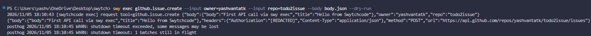
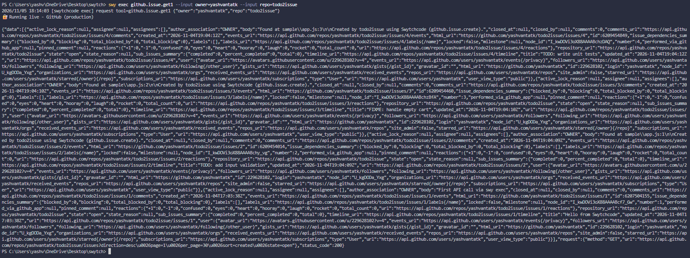
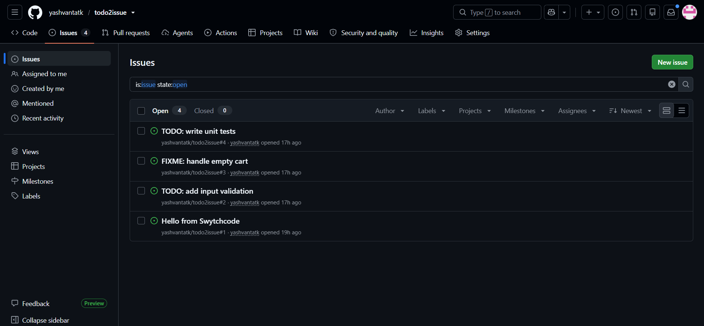

# todo2issue: TODO comments to GitHub issues, through Swytchcode

Submission for the Swytchcode PPI task by Yashvant A T K (IIITDM Kancheepuram, B.Tech CSE, 2nd year).

## Problem and intended user
Developers leave `TODO:` / `FIXME:` comments in code and forget them. todo2issue scans a folder and files each comment as a GitHub issue, skipping ones already filed. Every GitHub call goes through the Swytchcode CLI, so the script never holds a GitHub token: Swytchcode's managed OAuth injects it at runtime.

Useful for: students and small teams who want their in-code TODOs tracked without setting up tokens or a GitHub App.

## API / integration explored
- Provider: `GitHub.github@1.1.4` (fetched with `swy get github`)
- `github.issue.create`: `POST /repos/{owner}/{repo}/issues` (inputs: `owner`, `repo` path params, `body` JSON struct with `title`, `body`)
- `github.issue.get1`: `GET /repos/{owner}/{repo}/issues` (list a repo's open issues; used for de-duplication)

## Environment
Windows 11, PowerShell, Node.js, Swytchcode CLI v2.25.1, editor `gemini`, mode `production` (GitHub has no sandbox endpoint).

## Setup and commands (exactly what I ran)
```powershell
npm install -g swytchcode          # added 2 packages in 4s
swy --version                      # 2.25.1
swy login                          # already logged in
swy whoami
swy init                           # editor 5 (gemini), mode 1 (production)
swy search github                  # GitHub.github@1.1.4
swy get github                     # also auto-created workspace "swytch"
swy list methods | Select-String issue
swy add github.issue.create
swy add github.issue.get1
swy auth connect github            # picked 2) <github>, browser OAuth
swy auth status
Set-Content body.json '{"title": "Hello from Swytchcode", "body": "First API call via swy exec"}'
swy exec github.issue.create --input owner=yashvantatk --input repo=todo2issue --body body.json --dry-run
swy exec github.issue.create --input owner=yashvantatk --input repo=todo2issue --body body.json
swy exec github.issue.get1 --input owner=yashvantatk --input repo=todo2issue
node todo2issue.js sample --dry-run
node todo2issue.js sample
node todo2issue.js sample          # second run: everything skipped
```

## What worked
- **First live call:** `swy exec github.issue.create` returned `status_code 201` and created [issue #1](https://github.com/yashvantatk/todo2issue/issues/1).
- **Dry-run** printed the full request (`POST https://api.github.com/repos/yashvantatk/todo2issue/issues`) with `"Authorization": "[REDACTED]"`, so I could check it before sending anything.
- **Listing:** `swy exec github.issue.get1` returned `200` and issue #1. The CLI filled the query defaults from the Wrekenfile itself (`state=open&sort=created&direction=desc&per_page=30&page=1`).
- **todo2issue:** dry-run previewed 3 issues; the live run created #2, #3, #4; the re-run printed `SKIP (already filed)` for all three.
- Every response comes wrapped as `{data, request, status_code}`, which made scripting easy.

## What did not work / errors encountered
Full table in the friction diary below. Main ones:
- `swy info github.issues.create` (ID from the docs) -> `error: canonical ID "github.issues.create" not found in any fetched providers or installed workflows`. The real ID is `github.issue.create` (singular), and it takes `owner` + `repo` + a `body` struct, not `--input repo=org/repo --input title=...` as in the docs example.
- The docs disagree with themselves: the Execution Pipeline page uses `github.issue.create`, while the CLI-only quickstart, Execute Tools and Manage Tools pages use `github.issues.create`.
- Listing issues is `github.issue.get1`, not any of `github.issue.list/list1/list2`; `swy list methods` shows no descriptions, so I found it by Ctrl+F in `wrekenfile.yaml`.
- The task and the "Set up a Project > Project structure" docs show `wrekenfile.yaml` in a newly initialized project; on my run it only appeared after `swy get github`.
- posthog telemetry `WARN` lines after almost every command (telemetry was on by default).

## How Swytchcode ran my call (mapped to the Execution Pipeline docs)
Per https://docs.swytchcode.com/guides/execution-pipeline/ every `swy exec` follows the same steps. For `github.issue.create`:
1. **Resolve tool:** found in `.swytchcode/tooling.json` because I ran `swy add` (an unlisted tool stops with exit code 2).
2. **Validate inputs:** `owner`, `repo` and the `body` struct checked against the Wrekenfile schema.
3. **Evaluate policies:** none defined, so allowed.
4. **Resolve endpoint:** mode `production` -> `https://api.github.com` + `/repos/{owner}/{repo}/issues`.
5. **Resolve credentials:** the OAuth token from `swy auth connect github` (shown as `[REDACTED]` in dry-run).
6. **Execution policy:** retries/timeouts from `manifest.json`.
7. **Execute + normalize:** response returned as `{data, request, status_code}`.

Note from the docs: a provider error (4xx/5xx) still exits `0`, so todo2issue checks `status_code === 201` instead of the exit code.

## How to reproduce
1. Install Node.js and `npm install -g swytchcode`.
2. `swy login`, clone this repo, `cd` into it.
3. `swy get github` (the methods are already allow-listed in `.swytchcode/tooling.json`).
4. `swy auth connect github`.
5. Change `OWNER`/`REPO` at the top of `todo2issue.js` to a repo of yours with Issues enabled.
6. `node todo2issue.js sample --dry-run`, then without `--dry-run`.

## How todo2issue works
1. Recursively scans the folder for `TODO:` / `FIXME:` (skips `.git`, `node_modules`, `.swytchcode`).
2. `swy exec github.issue.get1` -> set of open issue titles.
3. For each new comment, writes a temp JSON body and runs `swy exec github.issue.create --input owner=... --input repo=... --body <file>` (adds `--dry-run` if asked).
4. Parses the JSON the CLI prints and reports `CREATED #n`, `SKIP` or `FAILED`.

Known limits: de-dupe only sees the first 30 open issues (get1 default `per_page=30`) and ignores closed ones; Node prints a `DEP0190` warning because I spawn `swy` with `shell: true` (npm installs it as `swy.cmd` on Windows).

## Screenshots and logs




Full redacted run log: [logs/run-log.md](logs/run-log.md)

## Demo
Watch the demo: https://youtu.be/gyCU685gAgc

## Notes on the generated Wrekenfile
- Location: `.swytchcode/integrations/GitHub/github/1.1.4/wrekenfile.yaml`, about 100k lines generated from GitHub's REST spec, plus `methods.json` listing canonical IDs.
- Each method block has a `CANONICAL_ID`, `ENDPOINT`, `HTTP` method, `INPUTS` (with location `path`/`query`/`body` and `required`), `RETURNS` and error statuses. For `github.issue.create`: errors 400, 403, 404, 410 (Issues disabled), 422, 503.
- No credentials in the method block: auth comes from `swy auth connect` at runtime.
- I inspected it and used it without changes. Modifying it is optional in the task, and the generated file already covered both operations I needed.

## Friction diary
| # | Step | Command | Expected | Actual | Tried next | Resolved? |
|---|---|---|---|---|---|---|
| 1 | Log in | `swy login` | Login flow or a "logged in as X" confirmation | `You are already logged in.` plus posthog `WARN: shutdown timeout exceeded` lines | `swy whoami` | Minor: noisy; doesn't say which account |
| 2 | Check account | `swy whoami` | Account + status | Session `valid (expires in 17 minutes)` with no hint how to refresh; posthog warnings again | - | Watch |
| 3 | Init project | `swy init` | Choose editor + mode with guidance | Works; mode prompt doesn't explain sandbox for providers with no sandbox endpoint (GitHub) | tooling.json docs, `mode` | Yes, picked production |
| 4 | Fetch integration | `swy get github` | Only fetches the bundle (quickstart) | Also silently `Created workspace "swytch"`; `integrations` stays `{}` | Workspaces docs | Yes, but confusing |
| 5 | Inspect Wrekenfile | `swy init`, look for Wrekenfile | Task: generated at init | Only appears after `swy get github` | Project structure docs | Yes (wording mismatch) |
| 6 | List methods | `swy list methods \| Select-String issue` | Clean list | posthog WARN lines again; telemetry on by default though llms.txt says opt-in | `swy config telemetry disable` | Harmless, looks like an error |
| 7 | Tool from docs | `swy info github.issues.create` | Schema shown | `canonical ID "github.issues.create" not found`; real ID `github.issue.create`; docs input example doesn't match | `swy list methods` | Yes |
| 8 | Pick a list method | `swy list methods` | One obvious list method | `list/list1/list2`, `get/get1/get2`, no descriptions; repo issue list is `get1` | Ctrl+F in wrekenfile.yaml | Yes |
| 9 | Connect GitHub | `swy auth connect github` | Browser opens | Undocumented prompt `1) <all> 2) <github>` | Picked 2 | Yes |
| 10 | Check auth | `swy auth status` | My GitHub connection | Adds "3 connected accounts in other workspaces are not shown here" | Noted | Partly |
| 11 | Call swy from Node (Windows) | `spawnSync("swy", args, {shell:true})` | Clean run | DEP0190 warning; shell needed for swy.cmd | Kept shell, fixed args | Yes (warning) |
| 12 | Re-read docs | compare pages | One consistent ID | Execution Pipeline uses `github.issue.create`; quickstart/Execute/Manage Tools use `github.issues.create` | Wrekenfile as truth | Yes (docs bug) |
| 13 | Error handling | Execute Tools > Exit codes | Non-zero exit on API error | 4xx/5xx still exit 0 | Script checks `status_code === 201` | Yes (by design) |

## AI usage
- **Hark (AI assistant):** read the task PDF and the Swytchcode docs, guided me step by step, drafted `todo2issue.js`, this README, the explainer and the LinkedIn post, and kept the friction diary as I reported output. I ran every command myself and checked every result.
- One AI mistake: it first told me to list issues with `github.issue.list`. That was wrong; Ctrl+F for `ENDPOINT: /repos/{owner}/{repo}/issues` in the Wrekenfile showed the right ID is `github.issue.get1`.

## Security
No API keys or tokens are in this repo. GitHub auth is Swytchcode managed OAuth; the dry-run output shows the Authorization header as `[REDACTED]`. Screenshots are redacted.